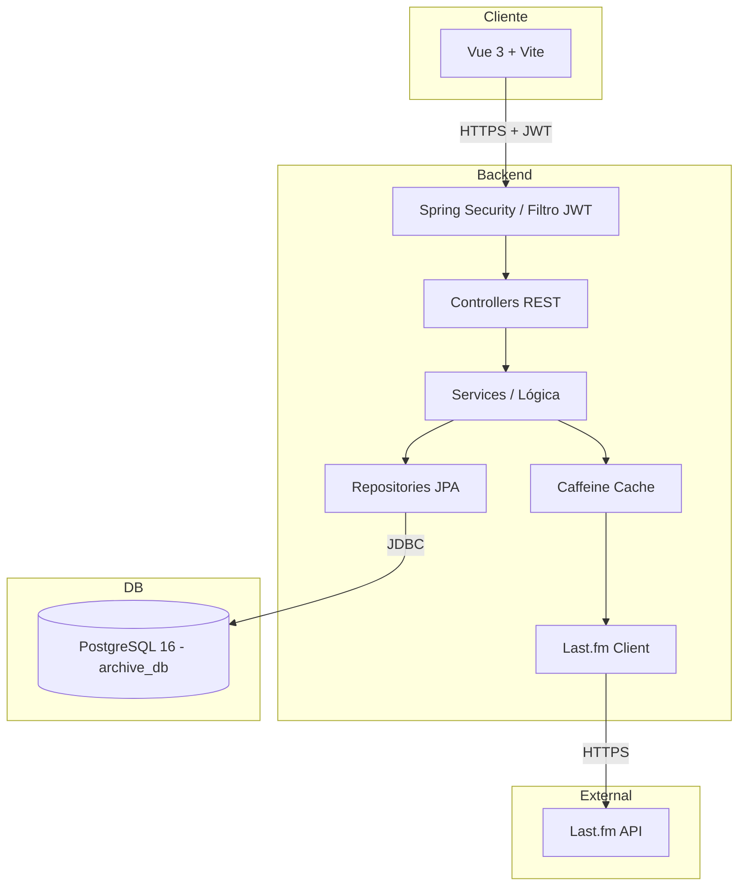
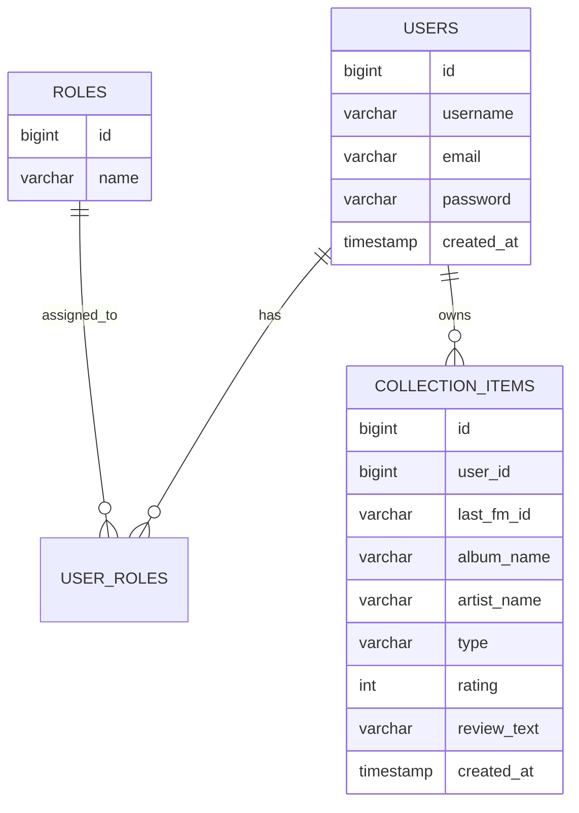
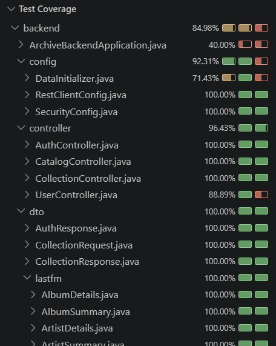

# Archive_00 — Backend

API REST para **Archive_00**, una red social de música centrada en el descubrimiento y la colección personal de álbumes.

<!-- AQUÍ CAPTURA: Logo o banner del proyecto -->

## Descripción

Archive_00 es una aplicación web que permite a los usuarios:

- Buscar álbumes y artistas (a través de la API de Last.fm).
- Guardar álbumes con una puntuación de 1 a 5 estrellas.
- Añadir álbumes a una lista de "escuchar más tarde" (Archive).
- Escribir reseñas personales.
- Ver y gestionar su colección personal desde su perfil.

Este repositorio contiene el **backend** (API REST). El frontend está en [este repositorio](https://github.com/simoneavilarranz/p5-digital-academy-project-archive00-frontend).

---

## Stack Tecnológico

- **Java 21**
- **Spring Boot 4.x**
- **Spring Security** + **JWT** (autenticación stateless)
- **Spring Data JPA** (persistencia)
- **PostgreSQL 16** (base de datos, dockerizada)
- **Caffeine Cache** (caché de respuestas de Last.fm)
- **Last.fm API** (fuente de datos musicales)
- **Lombok** (reducción de boilerplate)
- **JUnit 5 + Mockito + MockMvc** (testing)
- **Maven** (gestión de dependencias)

---

## Requisitos Previos

Antes de arrancar el backend, asegúrate de tener instalado:

- **Java 21** o superior.
- **Docker Desktop** (para PostgreSQL).
- **API Key de Last.fm** (gratuita, ver instrucciones abajo).
- **Git** (para clonar el repositorio).

---

## Instalación y Ejecución

### 1. Clonar el repositorio

```bash
git clone https://github.com/simoneavilarranz/p5-digital-academy-project-archive00-backend.git
cd p5-digital-academy-project-archive00-backend
```

### 2. Levantar la base de datos

```bash
docker compose up -d
```

Esto levantará un contenedor PostgreSQL 16 con la base de datos `archive_db`.

### 3. Arrancar el backend

```bash
./mvnw spring-boot:run
```

La API estará disponible en **`http://localhost:8080/api`**.

---

## Scripts Disponibles

| Comando | Descripción |
| :--- | :--- |
| `./mvnw spring-boot:run` | Arranca la aplicación en modo desarrollo. |
| `./mvnw test` | Ejecuta los tests unitarios y de integración. |
| `./mvnw clean package` | Genera el JAR de producción. |
| `docker compose up -d` | Levanta el contenedor de PostgreSQL. |
| `docker compose down` | Detiene el contenedor. |
| `docker compose down -v` | Detiene el contenedor y borra los datos. |

---

## Endpoints Principales

La API está prefijada con `/api` (configurado con `spring.mvc.servlet.path=/api`).

### Autenticación (público)

- **`POST /api/auth/register`** → Registro de usuario.
  - Body: `{ "username", "email", "password" }`
  - Respuesta: `{ "message", "token": null }`

- **`POST /api/auth/login`** → Login (devuelve JWT).
  - Body: `{ "email", "password" }`
  - Respuesta: `{ "message", "token" }`

### Usuarios (requiere JWT)

- **`GET /api/users/me`** → Perfil del usuario autenticado.
  - Respuesta: `{ "id", "username", "email", "createdAt" }`

### Catálogo (público, Last.fm)

- **`GET /api/catalog/search?q={query}`** → Busca álbumes y artistas.
- **`GET /api/catalog/album/{artist}/{album}`** → Detalle de un álbum con tracklist.
- **`GET /api/catalog/artist/{name}`** → Detalle de un artista con top albums.

### Colección personal (requiere JWT)

- **`POST /api/collections`** → Guardar o archivar un álbum.
  - Body: `{ "lastFmId", "albumName", "artistName", "coverUrl", "type": "SAVED"|"ARCHIVE", "rating", "reviewText" }`

- **`GET /api/collections/me?type=SAVED|ARCHIVE`** → Ver la colección propia (filtro opcional).
- **`PUT /api/collections/{id}/review`** → Escribir/editar reseña.
  - Body: `{ "reviewText" }`
- **`DELETE /api/collections/{id}`** → Eliminar un ítem de la colección.

---

## Arquitectura

El siguiente diagrama muestra el flujo entre el frontend, el backend, la base de datos y la API externa:



### Flujo de una petición típica

1. El usuario interactúa con el **frontend** (Vue).
2. **Axios** envía la petición al backend con el JWT en el header `Authorization`.
3. **Spring Security** valida el JWT con el `JwtAuthenticationFilter`.
4. El **Controller** recibe la petición y la delega al **Service**.
5. El **Service**:
   - Si necesita datos locales → usa el **Repository** (→ PostgreSQL).
   - Si necesita datos de Last.fm → consulta la **Cache** primero. Si no está, llama a **Last.fm API**.
6. La respuesta vuelve al **frontend** y se renderiza.

---

## Modelo de Datos

Entidades principales de la base de datos:



- **`USERS`** → Usuarios registrados.
- **`ROLES`** → Roles (USER, ADMIN).
- **`USER_ROLES`** → Relación ManyToMany entre usuarios y roles.
- **`COLLECTION_ITEMS`** → Ítems de la colección personal (SAVED o ARCHIVE, con rating y reseña opcionales).

---

## Decisiones Técnicas

### ¿Por qué JWT y no sesiones?

JWT es stateless. El servidor no guarda sesiones. Cada petición se autentica con el token. Esto:

- Facilita el despliegue en múltiples servidores.
- Simplifica el frontend (solo guarda el token en LocalStorage).
- Es el estándar en APIs REST modernas.

### ¿Por qué Caffeine Cache?

Last.fm tiene un límite de peticiones por minuto. Sin caché, las búsquedas repetidas agotarían el rate limit. Caffeine:

- Guarda las respuestas de Last.fm en memoria.
- Expira las entradas en 1 hora.
- Mejora el rendimiento 5x en búsquedas repetidas.

### ¿Por qué PostgreSQL y no MySQL?

Ambos son válidos. PostgreSQL es:

- Más robusto para relaciones complejas.
- Más estricto con los tipos y las constraints.
- El estándar en proyectos modernos.

### ¿Por qué el prefijo `/api`?

Todas las rutas están prefijadas con `/api` mediante `spring.mvc.servlet.path=/api`. Esto:

- Separa las rutas del backend de las del frontend.
- Evita conflictos si en el futuro se sirve el frontend desde el mismo dominio.
- Es la convención estándar en APIs REST.

---

## Tests

El proyecto incluye **tests unitarios** y **tests de integración**.

### Tests unitarios

- `AuthServiceTest` → registro y login.
- `CollectionServiceTest` → CRUD de la colección.
- `JwtServiceTest` → generación y validación de JWT.
- `CustomUserDetailsServiceTest` → carga de usuarios.
- `GlobalExceptionHandlerTest` → manejo de excepciones.
- `CollectionItemTest` → entidad de colección.
- `LastFmServiceTest` → parseo de respuestas de Last.fm (con `MockRestServiceServer`).

### Tests de integración

- `AuthControllerIntegrationTest` → endpoints de auth con MockMvc.
- `CatalogControllerIntegrationTest` → endpoints de catálogo con `LastFmService` mockeado.
- `CollectionControllerIntegrationTest` → endpoints de colección con `@WithMockUser`.
- `UserControllerIntegrationTest` → endpoint `/users/me`.

### Ejecutar los tests

```bash
./mvnw test
```

**Importante:** los tests de integración requieren que el contenedor de PostgreSQL esté corriendo. Ejecuta `docker compose up -d` antes de lanzar los tests.



---

## 📁 Estructura del Proyecto

```
src/main/java/com/archive/backend/
├── config/              # Configuraciones (Security, RestClient, DataInitializer)
├── controller/          # Controladores REST
├── dto/                 # Data Transfer Objects
│   └── lastfm/          # DTOs específicos de Last.fm
├── entity/              # Entidades JPA
├── exception/           # Excepciones personalizadas + GlobalExceptionHandler
├── repository/          # Repositorios JPA
├── security/            # JwtService, JwtAuthenticationFilter, CustomUserDetailsService
├── service/             # Lógica de negocio (Auth, Collection, LastFm)
└── ArchiveBackendApplication.java
```

---

## Enlaces

- [Frontend Repository](https://github.com/simoneavilarranz/p5-digital-academy-project-archive00-frontend)

---

## Autora

Simone Ávila Arranz